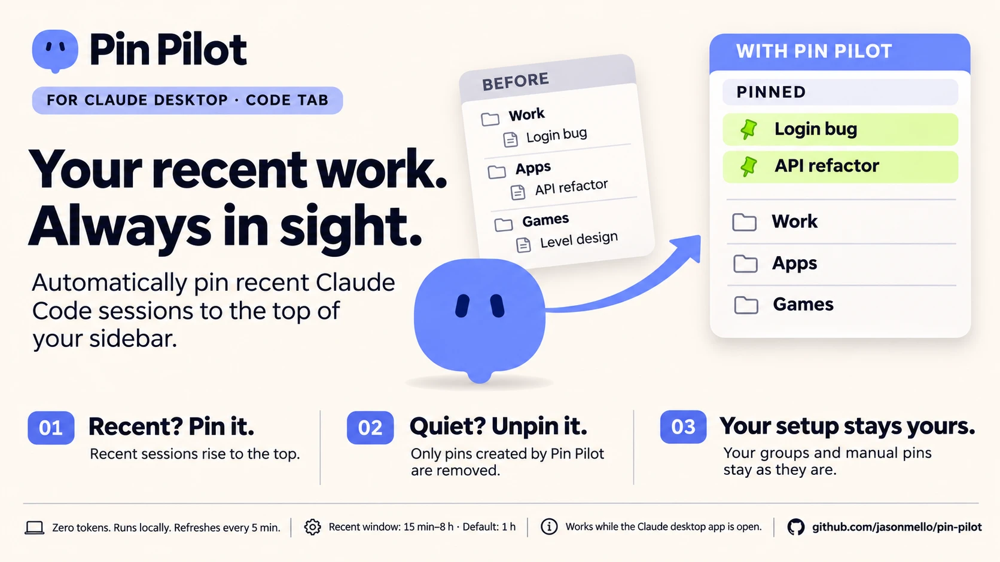

# Pin Pilot



**Always see what you are working on.** Pin Pilot keeps the Claude Code sessions you used recently pinned at the top of the Claude desktop app's sidebar, and unpins them on its own when they go quiet. No more scrolling through every group to find the conversations that are still running.

[](LICENSE)

> Works in the **Claude desktop app** (Code tab), while the app is open. It does nothing in the terminal-only Claude Code.

## The problem

If you use Claude Code for more than one thing, your sidebar fills up fast. You file sessions into groups (Work, Apps, Games, Clients...) to keep things tidy, and that works until you have several sessions going at the same time.

Then the questions start:

- *Which conversations was I working on an hour ago?*
- *Did that session finish, or is it waiting for my answer?*
- *Where did I leave the one about the login bug? Work or Apps?*

To answer them you open every group and scroll through all of it, every time. A session that needs you can sit there unnoticed for an hour, just because it was buried in a collapsed group.

## The fix

Pin Pilot keeps a short, always-current list at the very top of the sidebar: **the sessions you touched recently.** Open the app and that list is your "in progress" view. When a session goes quiet, it leaves the list by itself. Your groups stay exactly as you organized them.

Think of it as a "recent" shelf that tidies itself up.

## How it works

Every 5 minutes, Pin Pilot looks at your sessions:

- A session with activity in the last hour (you choose the window) gets **pinned**.
- A session **Pin Pilot pinned** that has gone quiet gets **unpinned**.
- Sessions **you** pinned by hand are never touched. Pin a session yourself to keep it at the top for good.
- Unpin one of its pins and Pin Pilot lets it be until you use that session again.

Your groups never change: a pinned session stays in its group. Pin Pilot uses no AI model and spends **no tokens**. It only calls the app's own pin and session-list functions, on your machine. It sends nothing anywhere.

## Install

**In the desktop app:** click **+** next to the prompt box, then **Plugins**, **Add marketplace**, type `jasonmello/pin-pilot`, then **Add plugin** on Pin Pilot.

**From a terminal session** (type `claude` first):

```
/plugin install pin-pilot --marketplace jasonmello/pin-pilot
```

**From a shell:**

```bash
claude plugin install pin-pilot --marketplace jasonmello/pin-pilot
```

It starts working in the next session you open, within a few seconds.

## Choose the time window

The window that counts as "recent" is a setting: 15 min, 30 min, 1 h (default), 2 h, 4 h or 8 h. Set it when you install, or later in the plugin's settings.

If the installer says an option is "not yet set", you can ignore it: Pin Pilot uses 1 hour until you pick another window. To set it from a shell instead:

```bash
claude plugin install pin-pilot --marketplace jasonmello/pin-pilot --config window=2h
```

## Good to know

- It runs only while the desktop app is open with a session loaded. Close the app and nothing updates until you open it again.
- Uninstalling leaves at most a few sessions pinned; unpin them with a right-click.

## License

Apache License 2.0, see [LICENSE](LICENSE). Copyright 2026 Jason Mello. If you redistribute Pin Pilot or a work based on it, keep the [NOTICE](NOTICE) file with the original credit.

---

## Português

**Veja sempre no que você está trabalhando.** O Pin Pilot fixa no topo da barra lateral do app Claude (aba Code) as conversas que você usou recentemente, e desafixa sozinho quando elas ficam paradas. Chega de rolar todos os grupos para achar as conversas que ainda estão rodando.

> Funciona no **app desktop do Claude** (aba Code), com o app aberto. Não faz nada no Claude Code só de terminal.

### O problema

Se você usa o Claude Code para mais de uma coisa, a barra lateral enche rápido. Você organiza as conversas em grupos (Trabalho, Apps, Games, Clientes...) para manter a ordem, e isso funciona até você ter várias conversas rodando ao mesmo tempo.

Aí começam as perguntas:

- *Em quais conversas eu estava trabalhando uma hora atrás?*
- *Aquela conversa terminou ou está esperando minha resposta?*
- *Onde ficou a do bug do login? Em Trabalho ou em Apps?*

Para responder, você abre todos os grupos e rola tudo, toda vez. Uma conversa que precisa de você pode ficar uma hora esquecida, só porque estava escondida num grupo fechado.

### A solução

O Pin Pilot mantém uma lista curta e sempre atualizada bem no topo da barra lateral: **as conversas que você usou recentemente.** Abriu o app, essa lista é a sua visão do que está "em andamento". Quando uma conversa fica parada, ela sai da lista sozinha. Seus grupos continuam exatamente como você organizou.

Pense nele como uma prateleira de "recentes" que se arruma sozinha.

### Como funciona

A cada 5 minutos, o Pin Pilot olha suas conversas:

- Conversa com atividade na última hora (você escolhe a janela) é **fixada**.
- Conversa que **o Pin Pilot fixou** e ficou parada é **desafixada**.
- O que **você** fixou à mão nunca é mexido. Fixe uma conversa você mesmo para ela ficar no topo de vez.
- Desafixou uma conversa que ele fixou? Ele deixa quieta até você voltar a usá-la.

Seus grupos não mudam: a conversa fixada continua no grupo dela. O Pin Pilot não usa modelo de IA e **não gasta tokens**. Ele só usa as funções do próprio app de fixar e listar conversas, no seu computador, e não envia nada para lugar nenhum.

### Instalar

**No app desktop:** clique em **+** ao lado da caixa de mensagem, depois **Plugins**, **Add marketplace**, digite `jasonmello/pin-pilot` e clique em **Add plugin** no Pin Pilot.

**Numa sessão de terminal** (digite `claude` antes):

```
/plugin install pin-pilot --marketplace jasonmello/pin-pilot
```

**Pelo shell:**

```bash
claude plugin install pin-pilot --marketplace jasonmello/pin-pilot
```

Ele começa a funcionar na próxima conversa que você abrir, em poucos segundos.

### Escolha a janela de tempo

O que conta como "recente" é uma configuração: 15 min, 30 min, 1 h (padrão), 2 h, 4 h ou 8 h. Escolha na instalação ou depois, nas configurações do plugin.

Se o instalador avisar que uma opção "não foi definida" ("not yet set"), pode ignorar: o Pin Pilot usa 1 hora até você escolher outra janela. Para definir pelo shell:

```bash
claude plugin install pin-pilot --marketplace jasonmello/pin-pilot --config window=2h
```

### Bom saber

- Só roda com o app desktop aberto e alguma conversa carregada. Com o app fechado, nada se atualiza até você abrir de novo.
- Ao desinstalar, sobram no máximo algumas conversas fixadas; desafixe com o botão direito.

### Licença

Apache License 2.0, veja [LICENSE](LICENSE). Copyright 2026 Jason Mello. Se você redistribuir o Pin Pilot ou um trabalho baseado nele, mantenha o arquivo [NOTICE](NOTICE) com o crédito original.
